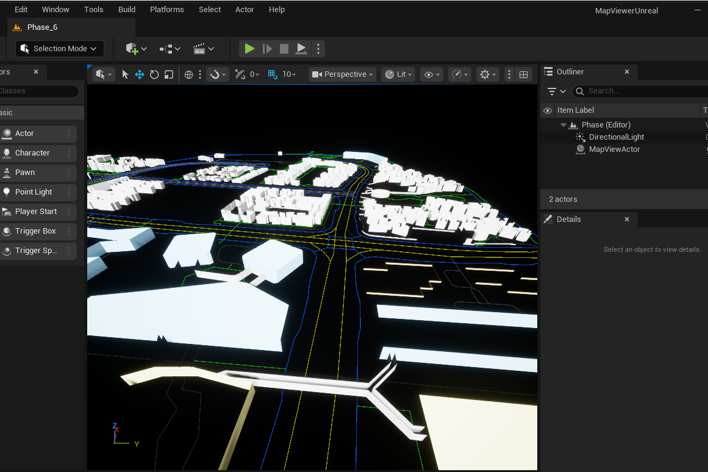

# geomapr

An OpenStreetMap viewer built in Unreal Engine 5. It reads roads, buildings and
points of interest from a SQLite database and draws them live, in the editor
viewport as well as in Play mode:

- **Roads** are drawn as coloured lines by road type, with level of detail based on camera height.
- **Buildings** are solid 3D shapes generated at runtime with `UProceduralMeshComponent`
  (walls plus a flat roof), grouped by colour so each colour is one draw call.
- **POIs** are drawn as poles, shown only when the camera is close enough.



The sample data in `Data/map_extended.db` covers part of Singapore.

## Requirements

| | Windows | macOS |
|---|---|---|
| Engine | Unreal Engine **5.8** (Epic Games Launcher) | Unreal Engine **5.8** (Epic Games Launcher) |
| Compiler | Visual Studio 2022 with *Game development with C++* | Xcode (run it once so the command-line tools are installed) |
| Other | Git LFS | Git LFS |

The project uses the engine plugins `SQLiteCore` and `ProceduralMeshComponent`.
Both come with the engine, so there is nothing extra to install.

## Getting the code

The `.umap` levels are stored with Git LFS, so install LFS before cloning:

```bash
git lfs install
git clone git@github.com:giraphics/geomapr.git
```

If you cloned without LFS, `Content/Phase_6.umap` is a small text pointer file
and the editor cannot open it. Run `git lfs pull` inside the repo to fetch it.

## Build on Windows

1. Close the Unreal Editor if it is open.
2. Run `build.bat` (double-click it, or run it from a command prompt).

   It assumes the engine is at `C:\Program Files\Epic Games\UE_5.8`. If yours
   is somewhere else, set `UE_ROOT` first:

   ```bat
   set UE_ROOT=C:\Program Files\Epic Games\UE_5.8
   build.bat
   ```

3. Open `MapViewerUnreal.uproject`.

To build from Visual Studio instead: right-click `MapViewerUnreal.uproject` and pick
**Generate Visual Studio project files**. Then open `MapViewerUnreal.sln`, set the
configuration to **Development Editor / Win64**, and build.

## Build on macOS

1. Close the Unreal Editor if it is open.
2. From the repo folder:

   ```bash
   ./build.sh
   ```

   This generates the Xcode project, then builds the editor target. It assumes the
   engine is at `/Users/Shared/Epic Games/UE_5.8`. If yours is somewhere else:

   ```bash
   UE_ROOT="/path/to/UE_5.8" ./build.sh
   ```

3. Open the project:

   ```bash
   open MapViewerUnreal.uproject
   ```

To build from Xcode instead: open the generated `MapViewerUnreal (Mac).xcworkspace`,
select the **MapViewerUnrealEditor** scheme, and build.

## First run: point the map at the database

The level stores the database location as an absolute path. On a new machine it
points somewhere that doesn't exist, and the viewport stays black with no error
on screen. The only message is in the Output Log: `MapViewActor: cannot open ...`.

To fix it:

1. Open `Content/Phase_6` (it loads at startup by default).
2. In the **Outliner**, select **MapViewActor**.
3. In **Details → Map → Database Path**, enter the full path to `Data/map_extended.db`
   in your clone, for example:
   - Windows: `C:\dev\giraphics\geomapr\Data\map_extended.db`
   - macOS: `/Users/<you>/dev/giraphics/geomapr/Data/map_extended.db`
4. Save the level (**Ctrl+S** / **Cmd+S**).

The map should appear in the viewport right away. Press **Play** to fly around it.

## Clean

To delete everything the build generates (`Binaries`, `Intermediate`,
`DerivedDataCache`, `Saved`):

- Windows: `clean.bat`
- macOS: `./clean.sh`

## Settings on MapViewActor

All of these are in the Details panel:

| Property | Default | What it does |
|---|---|---|
| `DatabasePath` | – | Absolute path to the SQLite map database |
| `EditorViewRadiusM` | 3000 | Area (metres) loaded in the editor viewport without pressing Play |
| `Lod0AltM` / `Lod1AltM` / `Lod2AltM` | 40000 / 12000 / 3000 | Camera heights (metres) where road detail changes |
| `ShowBuildingsAltM` | 2000 | Buildings are shown below this camera height |
| `ShowPoisAltM` | 600 | POIs are shown below this camera height |
| `CacheMargin` | 0.20 | Extra area queried around the view, so small camera moves don't hit the database again |
| `CheckIntervalSeconds` | 0.1 | How often the camera position is checked for a new query |

## Project layout

```text
Config/          Engine, game and input settings (startup map = Phase_6)
Content/         Phase_6.umap (main level), Phase_2.umap (earlier roads-only level)
Data/            map_extended.db – sample OSM data (Singapore)
Source/          C++ module MapViewerUnreal
  MapViewActor   Queries the database and draws roads, buildings and POIs
  MapViewerGameMode
docs/            Notes on editor-mode rendering and the database path
build.bat/.sh    Build the editor target (Windows / macOS)
clean.bat/.sh    Delete generated build folders
```
